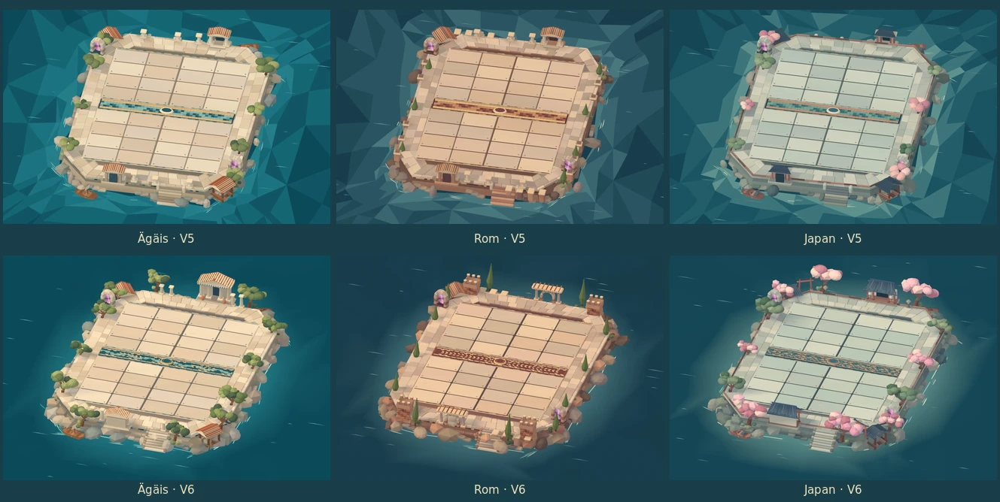
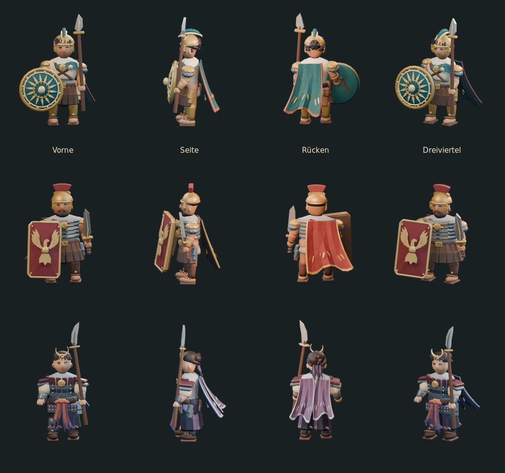

# Grafikreview für Pantheon Defense V6

Die erste Runde prüfte die drei Karten und 60 Figuren aus V5 gegen die Entwürfe. In der zweiten Runde habe ich die Kartenarchitektur, die Ausrüstung und die Silhouetten überarbeitet. Danach habe ich die Ergebnisse aus mehreren Winkeln und im Spielfeld verglichen und Stoff, Schilder, Fernkampfwaffen und den Bildausschnitt nachkorrigiert. [Kartenentwurf](arenas.webp) · [Heldenentwurf](champions.webp)

## Karten

| Region | Im Vergleich aufgefallen | Überarbeitung |
| --- | --- | --- |
| Ägäis | Der flache Unterbau und das stark facettierte Wasser lenkten vom Tempel und dem Mosaik ab. | Vorhalle mit kannelierten Säulen, gestaffeltes Ufer, Olivenbäume und ein Mosaik mit Wellen und Blättern. |
| Rom | Die Dachformen erinnerten noch an die Ägäis. Die Zitadelle hatte wenig eigenes Profil. | Triumphbögen mit sichtbaren Keilsteinen, gemauerte Zinnentürme, Zypressen und ein Lorbeermosaik. |
| Japan | Schrein und Vegetation gingen in der Silhouette unter. | Schrein mit geschwungenen Schieferdächern, sichtbaren Shōji-Rahmen und Torii, rosa Kirschkronen und eine Einlegearbeit mit Seigaiha-Wellen. |

## Truppen und Helden

Thekla trägt den Bronzerundschild aus dem Entwurf mit stärkeren Sonnenstrahlen, dazu einen gefalteten petrolfarbenen Mantel und einen eingefassten Helmaufsatz. Marcus hat einen breiteren Oberkörper, dunklere Eisenlamellen und einen gewölbten Scutum mit Adlerprägung. Akaris Elfenbeinärmel, die korallfarbene Schärpe, der gemusterte Hakama-Saum und die gebogene Naginata geben ihr eine eigene Kontur. In den Rückenansichten ragten bei mehreren Figuren Teile der Rüstung durch den Stoff. Nach der Korrektur liegen die Falten sichtbar über der Rüstung.

Für die 36 Truppen und 24 Helden habe ich außerdem Ausrüstung und Körperformen nach Rolle abgeglichen. Bogenschützen tragen stärker ausgeformte Bögen und sichtbare Köcher. Verhüllte Einheiten haben modellierte Kapuzen. Der Bronzewächter und der Schreinlöwe sind an ihren Masken zu erkennen. Der Adlerträger trägt den Adler oben auf der Standarte. Die Porträts zeigen pro Region zuerst die Truppen und dann die Helden. [Alle 60 Figuren](kader-v6.webp)

## Im Spiel

Im Hochformat hält der neue Bildausschnitt die Küstenkante und die Architektur sichtbar. Die kompakte Bossanzeige lässt darüber mehr Platz. Die Aufnahmen stammen aus Chromium mit Touch-Eingabe, Vollbild und einem Viewport von 390 × 844 CSS-Pixeln. Die Prüfszene enthält auf jeder Karte Truppen, Helden, Gebäude und Gegner. [Spielfeldaufnahmen](spielbrett-hochformat-v6.webp)
