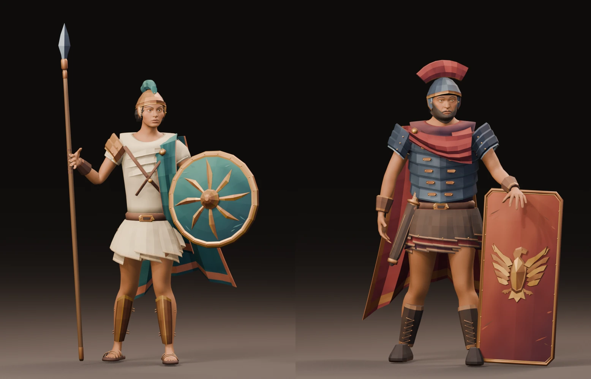

# Thekla und Marcus zur Abnahme

Thekla trägt jetzt tiefes Jade, warme Kupfertöne und abgeriebenen Schildlack. Marcus hat kühleren Stahl und Rostrot mit dunklen Violetttönen in den Stofffalten. Die gemalten Kanten, Falten und Gebrauchsspuren stecken in den Farben der exportierten Spielmodelle.



Der direkte Vergleich zeigt dieselbe Pose, Kamera und Beleuchtung. [Vorher und Handpainted](vorher-nachher.webp)

[Schilde und Rüstung im Detail](oberflaechen.webp) · [Stofffalten von hinten](bemalte-umhaenge.webp)

## Erste Abnahmerunde

| Ansicht | Was sich daran prüfen lässt |
| --- | --- |
| [Gesichter und Helme](nahaufnahmen.webp) | Gesichter, Haaransätze, Bart, Helmformen und Oberflächen |
| [Seiten und Rücken](seite-und-ruecken.webp) | Ärmel, Umhänge, Schildgurte und die Form der Schilde |
| [Angriffsposen](aktion.webp) | Theklas Speerstoß und Marcus’ Signal mit gestütztem Schild |
| [Spielfeld im Desktop-Browser](spielansicht.webp) | Wie beide Figuren bei der tatsächlichen Kameradistanz wirken |

In den Blender-Szenen sind die Bauteile und die Rig-Animationen editierbar. [Thekla](../../blend/thekla.blend) · [Marcus](../../blend/marcus.blend)

Die Grundanatomie stammt aus MakeHuman unter CC0. Posen, Ausrüstung, Kostümschnitte und Materialoberflächen sind für diese Figuren ausgearbeitet. [CC0-Lizenztext](../../reference-data/MakeHuman-CC0.md)

Im lokalen Desktop-Test haben beide Karten mit den neuen GLB-Dateien gerendert. In der emulierten Handy-Ansicht blieb der Boden der Ägäis-Karte in der Spielprobe leer.

Neue Aufnahmen aus den Blender-Dateien lassen sich mit folgendem Befehl erzeugen.

```sh
blender -b --python-exit-code 1 --python art/render_commander_review.py -- --output /tmp/figuren-abnahme
```
